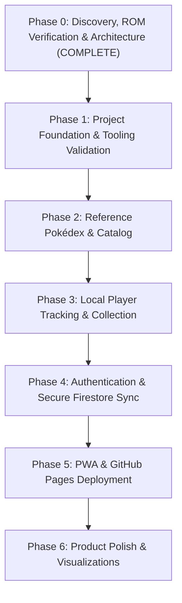

# Phase 0 — Discovery and Architecture Report
**Project**: Pokémon Definitive Pokédex (FireRed Definitivo PT-BR v2.0.4)  
**Role**: Principal Software Architect, Senior Angular Engineer & Driver  
**Navigator**: User  
**Status**: Phase 0 Complete — Final Approved Architectural Baseline  
**Date**: October 2026

**Historical artifact / current supersession note (November 5, 2026)**: This discovery record preserves earlier proposals. Current reference contracts and the TypeScript seed are defined by [the domain model](../domain-model.md) and [the Phase 2 artifact](./phase-2-reference-pokedex-and-catalog.md). Earlier JSON paths, evolution enums, and the all-tables schema-v1 example below are historical, not instructions to recreate those assets or schemas. Actual schema v1 contains only reference tables; later player tables require an approved migration. Dexie arrived in Phase 2; ESLint was superseded by explicit app/test typechecks plus Prettier. Offline application reload/installability belongs to Phase 5.  

---

## 1. Specification Analysis & Business Goals

The **Definitive Pokédex** is a mobile-first, offline-first Progressive Web Application tailored to the ROM hack *Pokémon FireRed Definitivo PT-BR v2.0.4*.

### Core Goals
1. **Accurate ROM Dataset**: Support the complete National Pokédex (#001 Bulbasaur through #386 Deoxys) incorporating the verified ROM hack modifications (non-trade evolution mechanics, Fairy-type additions, custom dual types, and physical/special split mechanics).
2. **Collection vs. Registration Invariant**: Decouple *species registered in the Pokédex* from *specimens currently owned*. Evolving or releasing a specimen must never erase the fact that the species was registered.
3. **Multi-Specimen Support**: Allow players to catch and track duplicate specimens (e.g., catching multiple Eevees or multiple Pikachus with independent nicknames, levels, and capture dates).
4. **Independent Player Profiles under One Account**: An authenticated account (e.g., a parent with a Google account) can own multiple independent player journeys (e.g., "Parent", "Child 1", "Child 2") without requiring children to have independent Google accounts. Profiles are independent gameplay journeys, not independently authenticated security principals.
5. **Zero-Friction Offline Experience**: The app must be fully interactive without an active network connection, persisting immediately to IndexedDB via Dexie.js and synchronizing transparently to Cloud Firestore when online.
6. **Integrity & Safety**: Prevent cross-account contamination, accidental data deletion, and ghost evolutions on branching trees.
7. **Clean Profile Initialization**: New player profiles start with clean, empty progress by default. Legacy spreadsheet importing (`.xlsm`/`.xlsx`) is excluded from application scope. The author workbook remains strictly a development reference and test fixture.

---

## 2. Verified ROM Data Analysis & Provenance Audit

We inspected both the author workbook (`Pokedex_Pessoal_FireRed_Definitivo_v2.0.4.xlsm`) and the binary ROM (`FRDefinitivo-v2.0.4.gba`) directly on disk.

### Dataset Verification Results
- **Binary Header**: Base game is Pokémon FireRed (Game Code `BPRE`, version 0), expanded to **32 MB**.
- **Species Table**: Exactly **386 species** (#001 through #386) mapped from internal Gen 3 indices 1..411 via `sSpeciesToNationalPokedexNum` at offset `0x251fee`.
- **Evolution Table (`EvoTable`)**: Contains **184 custom evolution transitions**. Traversal confirmed the evolution network is a **100% Directed Acyclic Graph (DAG) with zero cycles**.
- **Type Mechanics & Binary Inspection (`gBaseStats` at `0x254784`)**:
  - The ROM contains 19 types: Types 0..17 (standard Gen 3) plus **Type ID 18 = FAIRY**.
  - **17 Fairy Pokémon verified**:
    - *Pure Fairy*: Clefairy (#035), Clefable (#036), Cleffa (#173), Togepi (#175), Snubbull (#209).
    - *Normal / Fairy*: Jigglypuff (#039), Wigglytuff (#040), Igglybuff (#174), Azurill (#298).
    - *Water / Fairy*: Marill (#183), Azumarill (#184).
    - *Psychic / Fairy*: Mr. Mime (#122), Ralts (#280), Kirlia (#281), Gardevoir (#282).
    - *Fairy / Flying*: Togetic (#176).
    - *Steel / Fairy*: Mawile (#303).
  - **Critical ROM-Specific Facts Caught**:
    - **Granbull (#210)**: In this ROM, Granbull is **NORMAL / DARK** (not pure Fairy!).
    - **Porygon (#137)**: In this ROM, Porygon is **NORMAL / PSYCHIC** (not pure Normal!).
    - Verifying directly against the binary prevented applying canonical Gen 6+ assumptions that would have violated ROM truth.
- **Trade Evolution Adaptations in ROM**:
  - *Kadabra → Alakazam*: Level 48
  - *Machoke → Machamp*: Level 48
  - *Graveler → Golem*: Level 45
  - *Haunter → Gengar*: Level 44
  - *Onix → Steelix*: Level 47
  - *Scyther → Scizor*: Level 47
  - *Seadra → Kingdra*: Level 47
  - *Porygon → Porygon2*: Level 43
  - *Poliwhirl → Politoed*: Level 46
  - *Slowpoke → Slowking*: Water Stone
  - *Eevee → Espeon*: Sun Stone
  - *Eevee → Umbreon*: Moon Stone
  - *Clamperl → Gorebyss / Huntail*: Level 36 with Personality branches A and B
  - *Nincada → Ninjask & Shedinja*: Level 20 special event

> [!IMPORTANT]
> **Copyright & Asset Protection**: The copyrighted ROM (`FRDefinitivo-v2.0.4.gba`) and any save files (`*.sav`) are permanently ignored in [.gitignore](../../.gitignore) and will never be committed to Git. The originally proposed JSON asset path is superseded by the current metadata module [`src/app/core/data/pokedex-seed.data.ts`](../../src/app/core/data/pokedex-seed.data.ts).

---

## 3. Recommended Architecture & Technology Stack

```
+-------------------------------------------------------------------------+
|                              PRESENTATION                               |
|        Angular (Validated Stable Release, Signals, Reactive UI)         |
|           Angular Material + Custom Mobile-First Pokédex SCSS           |
+-------------------------------------------------------------------------+
                                    |
                                    v
+-------------------------------------------------------------------------+
|                                DOMAIN                                   |
|   Pure TypeScript Entities, 4-Tier Evolution Engine, Domain Invariants  |
|         ProfileContextService (Active profile signal & isolation)       |
+-------------------------------------------------------------------------+
                                    |
         +--------------------------+--------------------------+
         v                                                     v
+----------------------------------+        +-----------------------------+
|        LOCAL PERSISTENCE         |        |      CLOUD PERSISTENCE      |
|  Dexie.js v4 (IndexedDB)         |        |  Cloud Firestore            |
|  - Species (Static Reference)    | <====> |  - /users/{uid}/profiles/...|
|  - EvolutionRules (Static)       |  Sync  |  - Security Rules Enforced  |
|  - Profiles, Specimens, Events   | Engine |  - Firebase Auth (Google)   |
|  - SyncQueue (Outbox pattern)    |        |                             |
+----------------------------------+        +-----------------------------+
```

### Key Architectural Choices
1. **Angular Signals over Heavy Stores**: Angular Signals (`signal`, `computed`) provide reactive state without NgRx boilerplate. A clean `ProfileContextService` holds the active profile signal; specimen lists, filters, and completion statistics derive reactively.
2. **Offline-First Outbox Pattern**: When a user performs an action (capture, evolve, rename), the app writes synchronously to IndexedDB (Dexie) and atomically enqueues an operation into `syncQueue`. When online and authenticated, the `SyncEngine` flushes pending operations to Firestore using batched writes.
3. **Strict 4-Layer Isolation Boundary**:
   - *UI Layer*: Route boundaries and signal clearing on profile switch or sign-out.
   - *Local Storage Layer*: Dexie repositories strictly scope queries by composite keys (`userId`, `profileId`).
   - *Sync Engine*: Outbox queue maps strictly to `/users/{userId}/profiles/{profileId}`.
   - *Cloud Security Rules*: Firestore rules strictly enforce `request.auth.uid == userId` with comprehensive field and type validation.
4. **Canonical Versioned JSON Backup**: Full backup export and import works 100% offline without Firebase dependency. Zod schema validation protects against corruption, and imports strictly follow non-destructive restoration policies. CSV is excluded from the MVP.

---

## 4. Domain Model, Contracts & Atomic Consistency

### 4-Tier Evolution Eligibility Model
Do not assume a Pokémon can evolve immediately merely because its recorded level meets a threshold. The domain engine evaluates four formal states:

| Evolution State | Definition | Example |
| :--- | :--- | :--- |
| `FINAL_STAGE` | Species has no outgoing evolution transitions in the ROM dataset. | Charizard (#006), Blastoise (#009), Gengar (#094). |
| `EVOLUTION_PATH_AVAILABLE` | Species has outgoing evolution transitions in the ROM, but requirements are not yet confirmed met. | Charmander at Lv 10 (needs Lv 16); Eevee without an item. |
| `REQUIREMENTS_REPORTED_MET` | Known specimen conditions (e.g. level >= threshold, or user reports holding required item) are verified met. | Charmander at Lv 16+; Eevee when user initiates Water Stone evolution. |
| `CONDITION_UNKNOWN` | Evolution depends on in-game factors external to the tracker (personality branch, happiness, internal game flag). | Wurmple (Silcoon vs Cascoon personality branch); Tyrogue stat balance. |

*Note: Evolution eligibility is strictly separated from whether the destination species has already been registered in the Pokédex.*

### Domain Contracts & Schemas

Historical draft examples: current Phase 2 methods are `LEVEL_UP`, `ITEM`, `HAPPINESS`, `PERSONALITY`, and `SPECIAL`; the type union also includes MYSTERY. See [the current model](../domain-model.md). Player contracts remain subject to Phase 3 approval.

```typescript
export type PokemonType =
  | 'NORMAL' | 'FIRE' | 'WATER' | 'GRASS' | 'ELECTRIC' | 'ICE'
  | 'FIGHTING' | 'POISON' | 'GROUND' | 'FLYING' | 'PSYCHIC' | 'BUG'
  | 'ROCK' | 'GHOST' | 'DRAGON' | 'STEEL' | 'DARK' | 'FAIRY';

export type EvolutionMethod =
  | 'LEVEL'
  | 'ITEM'
  | 'FRIENDSHIP'
  | 'STAT_COMPARISON'
  | 'PERSONALITY'
  | 'SPECIAL';

export type EvolutionEligibility =
  | 'FINAL_STAGE'
  | 'EVOLUTION_PATH_AVAILABLE'
  | 'REQUIREMENTS_REPORTED_MET'
  | 'CONDITION_UNKNOWN';

export interface Species {
  readonly id: number; // 1 to 386
  readonly name: string;
  readonly primaryType: PokemonType;
  readonly secondaryType?: PokemonType;
  readonly baseStats: {
    hp: number;
    attack: number;
    defense: number;
    speed: number;
    spAttack: number;
    spDefense: number;
    total: number;
  };
  readonly spriteUrl?: string;
}

export interface EvolutionRule {
  readonly id: string; // e.g. "evo_4_5"
  readonly fromSpeciesId: number;
  readonly toSpeciesId: number;
  readonly method: EvolutionMethod;
  readonly condition: string;
  readonly minLevel?: number;
  readonly item?: string;
  readonly notes?: string;
}

export interface PlayerProfile {
  readonly id: string; // UUID
  readonly userId: string; // Firebase UID or "local"
  name: string;
  avatar?: string;
  isArchived: boolean;
  createdAt: string; // ISO
  updatedAt: string; // ISO
}

export type SpecimenStatus = 'OWNED' | 'RELEASED' | 'TRADED_AWAY';
export type AcquisitionMethod = 'CAUGHT' | 'EVOLVED' | 'GIFT' | 'TRADED';

export interface EvolutionHistoryEntry {
  readonly fromSpeciesId: number;
  readonly toSpeciesId: number;
  readonly evolvedAt: string;
  readonly evolutionRuleId: string;
  readonly levelAtEvolution?: number;
}

export interface PokemonSpecimen {
  readonly id: string; // UUID
  readonly profileId: string;
  readonly originalSpeciesId: number;
  currentSpeciesId: number;
  nickname?: string;
  level?: number;
  acquisitionMethod: AcquisitionMethod;
  acquisitionDate: string;
  status: SpecimenStatus;
  notes?: string;
  evolutionHistory: EvolutionHistoryEntry[];
  createdAt: string;
  updatedAt: string;
  isDeleted: boolean; // Soft-delete tombstone
}

export interface SpeciesRegistration {
  readonly id: string; // `${profileId}_${speciesId}`
  readonly profileId: string;
  readonly speciesId: number;
  isRegistered: boolean;
  firstObtainedAt: string;
  firstObtainedMethod: AcquisitionMethod;
  firstSpecimenId?: string;
  updatedAt: string;
}

/**
 * Domain Event Contract
 * Represents an immutable, auditable gameplay action.
 */
export type PokemonEventType =
  | 'SPECIMEN_CAPTURED'
  | 'SPECIMEN_EVOLVED'
  | 'SPECIMEN_RELEASED'
  | 'SPECIMEN_TRADED'
  | 'SPECIMEN_UPDATED'
  | 'PROFILE_RESTORED';

export interface PokemonEvent {
  readonly id: string; // UUID
  readonly profileId: string;
  readonly specimenId?: string;
  readonly eventType: PokemonEventType;
  readonly timestamp: string; // ISO
  readonly sequenceNumber: number; // Monotonic sequence for ordering
  readonly payload: Record<string, unknown>;
}

/**
 * Synchronization Operation Contract
 * Outbox queue entity representing an operation to be dispatched to Firestore.
 */
export type SyncOperationType = 'CREATE' | 'UPDATE' | 'DELETE';
export type SyncEntityType = 'PROFILE' | 'SPECIMEN' | 'REGISTRATION' | 'EVENT';

export interface SyncOperation {
  readonly id?: number; // Auto-incrementing Dexie ID
  readonly operationId: string; // UUID
  readonly profileId: string;
  readonly userId: string;
  readonly entityType: SyncEntityType;
  readonly entityId: string;
  readonly operationType: SyncOperationType;
  readonly payload?: Record<string, unknown>; // Snapshot of data for durable writes
  readonly createdAt: string; // ISO
  attempts: number;
  lastAttemptAt?: string;
  lastError?: string;
  readonly idempotencyKey: string; // Hash of (profileId + entityType + entityId + operationId)
}
```

### Atomic Local Transactions & State Consistency
To prevent desynchronization between owned specimens and registration state:
1. **Single Source of Local Truth**: All mutations execute inside a **Dexie atomic transaction** spanning `specimens`, `speciesRegistrations`, `pokemonEvents`, and `syncQueue`.
2. **Evolution Transaction Example**:
   - Evolving a specimen from species A to species B executes an atomic transaction that:
     1. Mutates `PokemonSpecimen` (updates `currentSpeciesId = B`, appends to `evolutionHistory`, updates `updatedAt`).
     2. Upserts `SpeciesRegistration` for species B (`isRegistered: true`, `firstObtainedAt = now`).
     3. Appends `PokemonEvent` (`SPECIMEN_EVOLVED`).
     4. Enqueues `SyncOperation` records for the specimen update, registration upsert, and appended event. (Consistency correction: the original two-operation example omitted event delivery.)
   - If any step fails, the entire transaction rolls back cleanly.
3. **Special Evolution Case (Nincada → Ninjask & Shedinja)**:
   - When evolving Nincada at Lv 20, if user confirms Shedinja was obtained, the atomic transaction:
     1. Mutates original specimen to Ninjask (#291).
     2. Creates a second distinct specimen for Shedinja (#292) with `acquisitionMethod: 'EVOLVED'`.
     3. Upserts registrations for both #291 and #292.
     4. Appends events and enqueues sync operations for all affected specimens, registrations, and events.

---

## 5. Persistence Schemas & Firestore Security Policy

### Dexie.js (IndexedDB) Schema

Historical target sketch only: this is not the implemented schema or a migration specification. Finalize ownership fields/composite keys and migration versions under the Phase 3 plan; see the open questions in [the domain model](../domain-model.md#4-design-questions-requiring-future-phase-approval).
```typescript
export class DefinitivePokedexDB extends Dexie {
  species!: Table<Species, number>;
  evolutionRules!: Table<EvolutionRule, string>;
  profiles!: Table<PlayerProfile, string>;
  specimens!: Table<PokemonSpecimen, string>;
  speciesRegistrations!: Table<SpeciesRegistration, string>;
  pokemonEvents!: Table<PokemonEvent, string>;
  syncQueue!: Table<SyncOperation, number>;

  constructor() {
    super('DefinitivePokedexDB');
    this.version(1).stores({
      species: 'id, name, primaryType, secondaryType',
      evolutionRules: 'id, fromSpeciesId, toSpeciesId, method',
      profiles: 'id, userId, name, isArchived, updatedAt',
      specimens: 'id, profileId, currentSpeciesId, status, updatedAt, isDeleted',
      speciesRegistrations: 'id, profileId, speciesId, isRegistered, updatedAt',
      pokemonEvents: 'id, profileId, specimenId, eventType, timestamp, sequenceNumber',
      syncQueue: '++id, operationId, profileId, userId, entityType, entityId, createdAt, attempts, idempotencyKey'
    });
  }
}
```

### Cloud Firestore Schema
All documents are partitioned strictly under the authenticated account:
```
/users/{userId}
   │
   ├── profiles/{profileId}
   │     ├── (document fields: name, avatar, isArchived, createdAt, updatedAt)
   │     ├── specimens/{specimenId}
   │     ├── registrations/{speciesId}
   │     └── events/{eventId}
```

### Firestore Security Policy (Phase 4 Specification)

> [!CAUTION]
> **Illustrative Preliminary Rules**: The snippet below illustrates basic ownership boundaries. It is **not production-ready security**. Production rules implemented in Phase 4 must enforce field schemas, type checks, immutable identity fields, and operation constraints.

```javascript
// =========================================================================
// ILLUSTRATIVE PRELIMINARY RULES — NOT PRODUCTION-READY SECURITY RULES
// Comprehensive field, type, and immutability validation will be built in Phase 4.
// =========================================================================
rules_version = '2';
service cloud.firestore {
  match /databases/{database}/documents {
    match /users/{userId} {
      allow read, write: if request.auth != null && request.auth.uid == userId;

      match /profiles/{profileId} {
        allow read, write: if request.auth != null && request.auth.uid == userId;

        match /{subcollection}/{docId} {
          allow read, write: if request.auth != null && request.auth.uid == userId;
        }
      }
    }
    match /{document=**} {
      allow read, write: false;
    }
  }
}
```

#### Production Validation Policy for Phase 4
During Phase 4, the security rules will be expanded to enforce:
1. **Authentication & Ownership**: `request.auth.uid == userId` on all operations.
2. **Document Field Validation**: Restrict documents to allowed schemas, enforcing mandatory strings, numbers, booleans, and ISO date formats.
3. **Immutable Identifiers**: Prevent modification of `userId`, `profileId`, `id`, `originalSpeciesId`, and `createdAt` on updates.
4. **Operation Constraints**:
   - `create`: Enforce presence of all mandatory fields; disallow initial `isDeleted: true`.
   - `update`: Enforce monotonic `updatedAt`; prevent resurrection of permanently deleted documents.
   - `delete`: Deny hard deletes where soft-deletes (`isDeleted: true`) are mandated.
5. **Automated Testing**: 100% of security rules validated against the Firebase Local Emulator using `@firebase/rules-unit-testing`, testing both unauthorized read/write attempts and malformed payloads.

---

## 6. Synchronization Safety & Non-Destructive Backup Contract

### Corrected Synchronization Conflict-Resolution Principle
> **Conflict resolution must preserve committed gameplay events and prevent silent data loss. The strategy must be formally defined and tested before implementation. Client timestamps alone must not be considered sufficient to guarantee conflict safety.**

#### Sync Engine Architecture & Guarantees
- **Bidirectional Reconciliation**: Remote updates must be fetched and integrated into Dexie without silently overwriting local mutations enqueued in the outbox.
- **Idempotency**: Retrying a sync operation with the same `idempotencyKey` produces identical remote state with zero duplicate records.
- **Concurrent Offline Modifications**:
  - In Phase 4, we will define explicit reconciliation rules per entity type:
    - `SpeciesRegistration`: Monotonic union (once registered, it remains registered; timestamps do not un-register).
    - `PokemonEvent`: Append-only log merge (events are uniquely identified and unioned; no events discarded).
    - `PokemonSpecimen`: Attribute reconciliation (e.g. highest level, preserved evolution history).
  - **Explicit Fallback**: If a concurrent specimen conflict cannot be safely and deterministically resolved automatically, the system must preserve the conflicting data and prompt the user for explicit resolution rather than silently discarding progress.
- **Deletion Propagation**: Soft-deletes with tombstones (`isDeleted: true`) ensure deletions sync reliably without re-creating deleted specimens.
- **Interrupted Sync Recovery**: The local `syncQueue` retains unacknowledged items across app restarts and resumes cleanly upon reconnection.

### Canonical Versioned JSON Backup Contract
1. **Format & Metadata**:
   - Canonical format: Single JSON document with explicit `schemaVersion: 1`.
   - Contains:
     - `metadata`: `exportDate`, `appVersion`, `schemaVersion`.
     - `profiles`: Array of `PlayerProfile`.
     - `specimens`: Array of `PokemonSpecimen`.
     - `registrations`: Array of `SpeciesRegistration`.
     - `events`: Array of `PokemonEvent`.
2. **Schema & Integrity Validation**:
   - Strict Zod schema validation on import.
   - Referential integrity checks (all specimens, registrations, and events map to a valid profile in the payload).
   - Rejects corrupted or tampered payloads with clear, localized error messages.
3. **Non-Destructive Restoration Policy**:
   - **Never silently overwrite existing progress.**
   - Restoration presents three explicit choices:
     1. *Restaurar como novo perfil* (preferred default — assigns fresh UUIDs and isolates data).
     2. *Mesclar com perfil existente* (only enabled once deterministic merge semantics are verified).
     3. *Substituir perfil existente* (requires typing the profile name to confirm destructive overwrite).
   - Functions 100% offline without Firebase connectivity.
   - CSV export/import is excluded from the MVP.

---

## 7. Phase-by-Phase Roadmap & Acceptance Criteria



### Phase 1 — Project Foundation & Tooling Validation
- **Goal**: Validate and install a stable Angular release, Vitest, Angular Material, Dexie, ESLint, Git CI, and core documentation.
- **Deliverables**:
  - Validated stable Angular app shell with strict TypeScript mode.
  - Custom Pokédex theme in SCSS (Pokédex Red `#DC0A2D`, Slate `#2A2A2A`, Surface `#F7F7F7`).
  - Vitest test runner running sample unit test suite.
  - GitHub Actions CI workflow (`ci.yml`) running lint, test, and build.
  - Core documentation suite in `docs/`.
- **Acceptance Criteria**: `npm run build`, `npm run test`, and `npm run lint` execute cleanly with 0 errors.

### Phase 2 — Reference Pokédex
- **Goal**: Import the verified ROM dataset (386 species, 184 evolution rules, 19 types), and build the searchable catalog with species detail views.
- **Deliverables**:
  - `firered-definitivo-v2.0.4.json` generated from verified ROM inspection.
  - Catalog component with virtual scrolling, type filters, and search.
  - Species detail modal displaying stats, types, evolution paths, and ROM notes.
- **Acceptance Criteria**: Search and type filters respond instantaneously; all 386 species and 184 evolution routes inspectable; unit tests verify evolution DAG navigation.

### Phase 3 — Local Player Tracking & Collection
- **Goal**: Implement IndexedDB (Dexie) persistence, multi-profile management, specimen tracking (captures, duplicates, evolutions), atomic transactions, dashboard statistics, and versioned JSON backup/restore.
- **Deliverables**:
  - Dexie database setup with typed repositories.
  - Profile manager (create, switch, rename, delete with confirmation; new profiles start empty).
  - Capture registration modal and specimen list view.
  - Evolution workflow enforcing all mandatory domain invariants inside atomic local transactions.
  - Dashboard showing registered count, owned count, evolvable specimens, and completion percentage.
  - Versioned JSON backup export and non-destructive import with Zod validation.
- **Acceptance Criteria**: 100% of the mandatory domain invariants verified by automated Vitest tests; profile switching produces zero state leakage; versioned JSON backup export/restore roundtrips cleanly without data loss.

### Phase 4 — Authentication & Secure Synchronization
- **Goal**: Add Firebase Authentication with Google Sign-In, Cloud Firestore schema, and offline-first outbox synchronization with conflict preservation.
- **Deliverables**:
  - Firebase Auth integration with Google provider.
  - Outbox SyncEngine executing batched writes to Firestore.
  - Firestore Security Rules with field, type, and immutability validation.
  - Security rules tested with `@firebase/rules-unit-testing` on the Local Emulator.
  - Multi-profile cloud sync with conflict detection and preservation.
- **Acceptance Criteria**: Emulator tests prove cross-account read/write attempts are denied; operations performed offline synchronize automatically when connectivity resumes; concurrent offline modifications do not silently discard gameplay progress.

### Phase 5 — PWA & Deployment
- **Goal**: Transform the app into an installable PWA with Service Worker asset caching, configure base href `/firered-definitive-pokedex/`, and deploy to GitHub Pages.
- **Deliverables**:
  - Angular Service Worker manifest and caching strategies.
  - GitHub Pages deployment workflow (`deploy.yml`).
  - Mobile viewport optimizations for Android small screens.
  - Playwright E2E tests validating the full offline user journey.
  - Acceptance Criteria: Lighthouse PWA audit passes; app installs cleanly on Android/desktop; runs completely offline after first load.

### Phase 6 — Product Polish & Visualizations
- **Goal**: Visual evolution family graphs, Brazilian Portuguese polish, keyboard accessibility, and final release verification.
- **Deliverables**:
  - Interactive evolution tree component showing linear and branching lines.
  - WCAG AA accessibility compliance and keyboard navigation.
  - Full Portuguese text audit.
  - Final architectural handoff document.
- **Acceptance Criteria**: WCAG AA accessibility compliance; zero console warnings; end-to-end verification report completed.

---

## 8. Resolved Architectural Decisions

| Decision | Resolution |
| :--- | :--- |
| **Pokémon Types Source** | **Verified from ROM**: Inspected `FRDefinitivo-v2.0.4.gba` directly on disk. Confirmed 19 types (Type 18 = Fairy), 17 Fairy species, Granbull as Normal/Dark, and Porygon as Normal/Psychic. |
| **Legacy Spreadsheet Import** | **Removed from Scope**: The application will NOT support importing `.xlsm`/`.xlsx` workbooks. The author workbook remains strictly a dev reference. New profiles start empty by default. |
| **Backup & Restoration** | **Canonical Versioned JSON**: Standalone JSON with `schemaVersion`, Zod validation, and non-destructive restore hierarchy (new profile default, merge only when defined/tested, replace with explicit confirmation). No CSV for MVP. |
| **Sync Conflict Safety** | **Preserve Committed Events**: Replaced last-write-wins timestamp claim. Mandated formal strategy preserving committed events and preventing silent data loss. Conflicting data preserved for explicit resolution. |
| **GitHub Pages Base Href** | **Approved**: Base href confirmed as `/firered-definitive-pokedex/` across router and deployment configs. |
| **Zero-Cost Constraint** | **Enforced**: Strictly Firebase Spark tier, Dexie IndexedDB, and GitHub Pages. No paid dependencies. |
| **Copyright Compliance** | **Enforced**: `*.gba` and `*.sav` added to `.gitignore`. No copyrighted binaries will ever be committed. |
